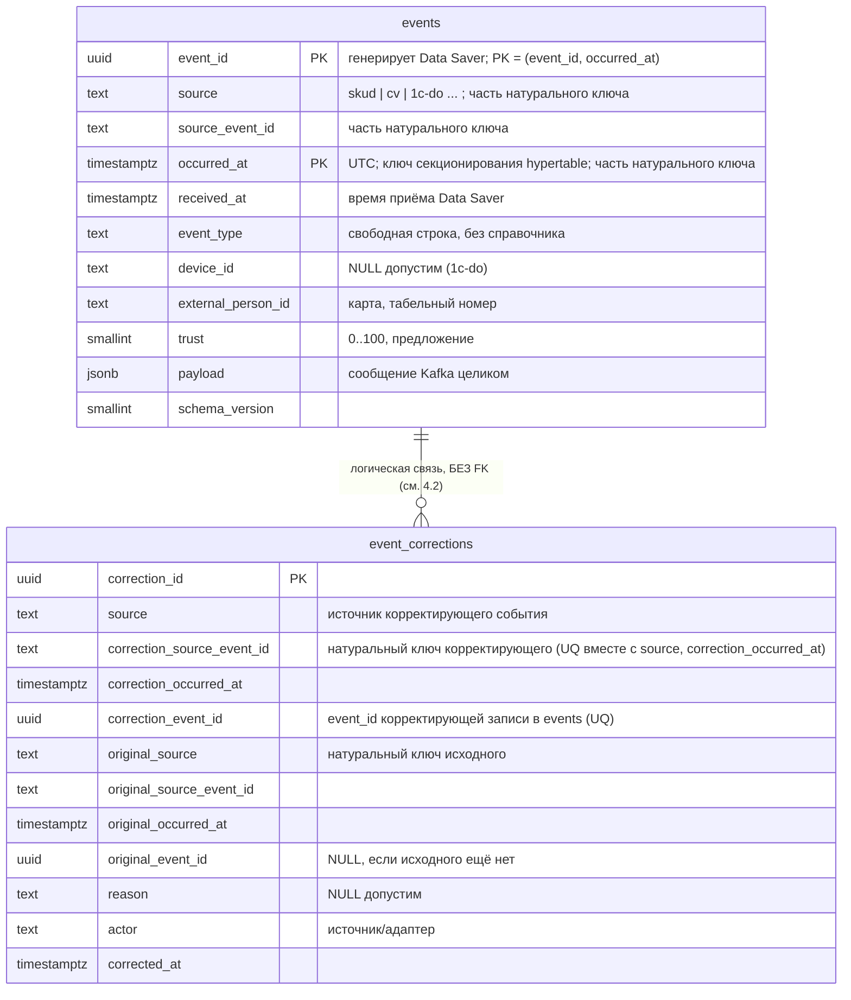

# Схема БД журнала событий (задача B3): ER, таблицы, индексы, права, черновик DDL

**Статус:** черновик для согласования. Только схема: код EF Core и миграции не входят.
**Дата:** 2026-11-19. **Ветка:** `feature/b3-events-schema`.
**СУБД:** PostgreSQL 16 + TimescaleDB 2.32.x (скрипты `db/` проверены на 2.32.1; на 2.31 не проверялись, см. п. 7, вопрос 8). **База:** `ktm_revisor`.

Основания: `docs/03-архитектура.md` (журнал неизменяем, исправления только корректирующими записями),
`docs/05-источники-данных.md` п. 5.1 (единый формат, идемпотентность по «источник + ID события + timestamp»),
`docs/07-нефункциональные-требования.md` (до 15 млн сырых событий в месяц, пик 500 событий/с, отчёт до 12 месяцев),
формат сообщения `docs/api/kafka-event-format.md` (ветка `task/event-contract-for-kafka`, раздел 8 и вопросы Q1-Q4 к B3;
в этой ветке файла ещё нет, ссылка справочная).

Пометка **«предложение»** означает значение, которого нет в требованиях; оно принято здесь по умолчанию и подлежит
подтверждению (раздел 7).

Границы: схема `skud` (`skud.skud_event`, роли `skud_migrator` и `skud_app`) относится к адаптеру СКУД и **не затрагивается**.
Журнал B3 - отдельная сущность в отдельной схеме `ktm` базы `ktm_revisor`, со своими ролями.

---

## 1. ER-диаграмма



Связь `events` - `event_corrections` показана логической: внешних ключей нет, причина в п. 4.2. Корректирующее событие
`correction_event_id` и исходное событие (по натуральному ключу `original_*`) - обе строки лежат в `events`.

---

## 2. Таблица `ktm.events`

Hypertable TimescaleDB по `occurred_at`. Только вставка: UPDATE и DELETE запрещены (раздел 5).

| Колонка | Тип | NULL | Назначение / источник значения |
|---|---|---|---|
| `event_id` | `uuid` | нет | Идентификатор записи; генерирует Data Saver (Q3 из `kafka-event-format.md`: при конфликте по ключу сгенерированный uuid отбрасывается). |
| `source` | `text` | нет | `skud`, `cv`, `1c-do`... Значение из сообщения. CHECK на список значений **не ставим** (новый источник не должен требовать миграции; допустимые значения проверяет валидация схемы сообщения). |
| `source_event_id` | `text` | нет | ID события в источнике, 1..128 символов (по контракту сообщения). |
| `occurred_at` | `timestamptz` | нет | Время события в источнике, UTC. Колонка секционирования. |
| `received_at` | `timestamptz` | нет | Время приёма Data Saver (`docs/05` п. 5.1 требует хранить). Заполняет приложение; значения по умолчанию `now()` нет, чтобы время задавалось единым образом на пачку. |
| `event_type` | `text` | нет | Тип события, `snake_case`. Справочника нет; отбраковка неизвестных - правило C5, не схема. |
| `device_id` | `text` | **да** | Турникет/дверь/камера. NULL для `1c-do` (Q1). Заменителей-констант не вводим. |
| `external_person_id` | `text` | нет | Идентификатор человека как в источнике. Привязка к сотруднику (`employee_id`) в журнал не входит - это уровень 1, отдельно. |
| `trust` | `smallint` | нет | Степень доверия к данным источника на момент приёма, 0..100 (предложение, см. 7.1). Источник значения - настройки источника, не сообщение. |
| `payload` | `jsonb` | нет | Всё сообщение Kafka как получено (`kafka-event-format.md` п. 8.2), включая вложенное поле `payload` и `correction`. |
| `schema_version` | `smallint` | нет | Версия формата сообщения (сейчас 1). |

Ключи и ограничения:

- `PRIMARY KEY (event_id, occurred_at)` - на hypertable любой уникальный ключ обязан включать колонку секционирования,
  поэтому `event_id` один уникальным быть не может. Ключ нужен для адресации записи и FK-подобных ссылок из `event_corrections`.
- `UNIQUE (source, source_event_id, occurred_at)` - **ключ идемпотентности** `docs/05` п. 5.1. Гарантию даёт схема БД, а не код.
- CHECK: `length(source) between 1 and 32`, `length(source_event_id) between 1 and 128`, `length(event_type) between 1 and 128`,
  `trust between 0 and 100`, `jsonb_typeof(payload) = 'object'`, `device_id is null or length(device_id) > 0`,
  `occurred_at` не NULL.
- Ограничение размера `payload` - см. 7.5.

---

## 3. Таблица `ktm.event_corrections`

Обычная таблица (не hypertable): исправления редки, объём на порядки меньше `events`. Только вставка.

Корректирующее сообщение Data Saver сохраняет двумя записями в одной транзакции: строка в `events` (обычное событие со своим
`sourceEventId`) и строка здесь (`kafka-event-format.md` п. 4 и 8.3). Исходное событие не меняется.

| Колонка | Тип | NULL | Назначение |
|---|---|---|---|
| `correction_id` | `uuid` | нет | PK, `DEFAULT gen_random_uuid()`. Не `identity`, чтобы роли сервиса не требовалось право на последовательность. |
| `source` | `text` | нет | Источник корректирующего события (из сообщения). |
| `correction_source_event_id` | `text` | нет | `sourceEventId` корректирующего сообщения. |
| `correction_occurred_at` | `timestamptz` | нет | `occurredAt` корректирующего сообщения. |
| `correction_event_id` | `uuid` | нет | `event_id` корректирующей записи **как она лежит в `events`** (при повторной доставке - ранее сохранённый, см. ниже). |
| `original_source` | `text` | нет | Источник исходного события. Сейчас всегда равен `source` (кросс-источниковые исправления контрактом не допускаются, п. 9 контракта - вопрос открыт); колонка заведена, чтобы их допуск не менял схему. |
| `original_source_event_id` | `text` | нет | `correction.correctsSourceEventId`. |
| `original_occurred_at` | `timestamptz` | нет | `correction.correctsOccurredAt`. Вместе с двумя предыдущими - натуральный ключ исходного. |
| `original_event_id` | `uuid` | **да** | `event_id` исходного, если на момент приёма он найден. NULL, если исходное событие ещё не пришло. |
| `reason` | `text` | **да** | `correction.reason`; в сообщении необязателен. |
| `actor` | `text` | нет | Кто исправил: имя источника/адаптера. Ручные исправления человеком в контракт не входят (там нужен пользователь из аудита). |
| `corrected_at` | `timestamptz` | нет | Когда: `received_at` корректирующей записи. |

Ключи:

- `PRIMARY KEY (correction_id)`.
- `UNIQUE (source, correction_source_event_id, correction_occurred_at)` - **ключ идемпотентности исправления**.
- `UNIQUE (correction_event_id)` - требование из `kafka-event-format.md` п. 8.3. Само по себе его для идемпотентности **недостаточно**:
  при повторной доставке Data Saver генерирует новый uuid, а `events` его отбросит по `ON CONFLICT DO NOTHING`; поэтому
  `correction_event_id` надо брать не из сгенерированного, а выборкой `event_id` по натуральному ключу корректирующего
  события после вставки (одна транзакция). Тогда обе уникальности сходятся. Это замечание к приложению Data Saver.
- Индекс `(original_source, original_source_event_id, original_occurred_at)` - чтение «действующей версии» события по натуральному
  ключу исходного (join к `events` по уникальному индексу `events`).

Чтение, когда `original_event_id IS NULL`: ссылка разрешается join по натуральному ключу, а не по `original_event_id`. UPDATE «дозаполнения»
невозможен (у сервиса нет права), поэтому и не предусмотрен.

---

## 4. Решения по TimescaleDB

### 4.1 Hypertable, партиции, политики (все значения - предложение)

| Параметр | Значение | Обоснование |
|---|---|---|
| Колонка секционирования | `occurred_at` | требование B3 |
| `chunk_time_interval` | 7 суток | 15 млн/мес даёт около 3,5 млн строк на чанк; индексы активного чанка (4 штуки) целиком помещаются в память; число чанков за 12 месяцев (глубина отчётов по `docs/07`) около 52, планирование запроса по ленте за период не страдает. Меняется без миграции данных (действует для новых чанков). |
| Компрессия (columnstore) | включить, политика через 30 суток; `segmentby = external_person_id`, `orderby = occurred_at DESC` | профиль запросов - лента человека за период. Старые данные читаются редко. Вставка «запоздавших» событий в сжатый чанк возможна (в т.ч. с проверкой уникального индекса), но дороже; для нашего профиля (дозагрузка в пределах суток-двух) не критично. |
| Retention | **автоматического удаления нет** | срок хранения сырых событий требованиями не задан (`docs/07` фиксирует хранение только логов и аудита). Автоудаление неизменяемого журнала без решения предприятия недопустимо. См. вопрос 7.3. |
| Индекс по времени | оставить создаваемый TimescaleDB по умолчанию `(occurred_at DESC)` | нужен выборкам «за период по всем людям» (уровень 2, дашборды). Если окажется лишним - отключается `create_default_indexes => false`. |

Названия функций в DDL (`add_compression_policy`) - классический API; в версиях 2.18+ он сохранён, но в документации
переименован в «columnstore» (`add_columnstore_policy`). На 2.32.1 классическое имя работает (проверено); на других версиях - повторить проверку (п. 7, вопрос 8).

### 4.2 Внешние ключи и hypertable - результат проверки

Проверено по текущей документации Tiger Data (бывший Timescale), страница «About constraints»
(`https://www.tigerdata.com/docs/use-timescale/latest/schema-management/about-constraints`):

- внешний ключ **из обычной таблицы на hypertable** в текущей документации значится **поддерживаемым**;
- внешний ключ **из hypertable на другую hypertable** - **не поддерживается**;
- старая документация и ранние issue (timescale/timescaledb#498) говорят, что ссылаться на hypertable нельзя. Источники расходятся;
  на конкретной версии 2.31 это **не проверено** (нет доступа к тестовому экземпляру) - проверить `ALTER TABLE ... ADD FOREIGN KEY` на стенде.

Вывод для нашей схемы: даже если FK технически возможен, использовать его **нельзя по смыслу**:

1. ссылаться можно только на уникальный ключ, а на hypertable он обязан включать `occurred_at`: `(event_id, occurred_at)` или
   `(source, source_event_id, occurred_at)`. Ссылка по одному `event_id` невозможна;
2. корректирующее сообщение может прийти раньше исходного (`kafka-event-format.md` п. 8.3); FK на натуральный ключ исходного
   отклонил бы такую строку, а контракт требует её сохранить;
3. FK добавляет блокировку/проверку по чанкам на каждой вставке при целевых 500 событий/с.

Поэтому **FK не создаём**; целостность обеспечивает приложение и индекс натурального ключа (так же, как зафиксировано в
`kafka-event-format.md` п. 8.3). Что даёт схема: `UNIQUE` на корректирующую пару и индекс по натуральному ключу исходного.

### 4.3 Установка расширения

`CREATE EXTENSION timescaledb` требует суперпользователя (расширение не «trusted») и выполняется один раз администратором
(на стенде предприятия уже установлено; init-скрипт его не создаёт, строка закомментирована), а не ролью миграций. Скрипт миграций проверяет его наличие и завершается ошибкой, если его нет.

---

## 5. Роли и права

Образец - схема ролей `skud_migrator`/`skud_app` в общей БД `ktm_revisor` (скрипта их создания в этом репозитории нет, ссылка на
него удалена). Роли и схема `skud` **не меняются**; для B3 вводятся отдельные роли (имена - предложение):

| Роль | Назначение | Права |
|---|---|---|
| `ktm_migrator` | DDL: владелец схемы `ktm`, применяет скрипт миграций. Сервису не выдаётся. | владелец `ktm`; `CREATE` на схему |
| `ktm_app` | Data Saver и читающие компоненты. | `USAGE` на схему `ktm`; на `events` и `event_corrections` только `SELECT, INSERT` |

Принципы:

- **UPDATE/DELETE/TRUNCATE у сервиса отсутствуют на уровне GRANT** - это критерий приёмки «UPDATE/DELETE запрещены сервису»;
  проверяется попыткой выполнения под `ktm_app` (ожидается `permission denied`).
- `ALTER DEFAULT PRIVILEGES FOR ROLE ktm_migrator IN SCHEMA ktm GRANT SELECT, INSERT ON TABLES TO ktm_app` - для таблиц, которые
  создаст миграция. Чанки hypertable наследуют привилегии родителя (TimescaleDB копирует ACL при создании чанка); это поведение
  **проверено на стенде** (2.32.1): вставка под `ktm_app` в только что созданный чанк проходит, ACL наследуется от родителя.
- `INSERT ... ON CONFLICT DO NOTHING` требует только `INSERT` (+ `SELECT` для вывода арбитра); `DO UPDATE` запрещён правами - и не нужен.
- Страховка поверх прав (предложение): триггер `BEFORE UPDATE OR DELETE` на обеих таблицах с `RAISE EXCEPTION`. Защищает от
  случайного `UPDATE` под владельцем. Не срабатывает на `drop_chunks` и сжатие - они не построчные.
- `GRANT CONNECT ON DATABASE <текущая БД> TO ktm_migrator, ktm_app` (имя берётся из `current_database()`). Фактически **избыточен**:
  `PUBLIC` по умолчанию уже имеет `CONNECT`, а отзыв не выполняется (см. ниже); `GRANT` оставлен как явная фиксация намерения
  и сработает без изменений, если `PUBLIC` когда-либо будет отозван.
- **Отступление: `REVOKE ALL ON DATABASE ktm_revisor FROM PUBLIC` НЕ выполняется** (решение лида проекта, 2026-11-20). База общая
  (есть роли `skud_*` и другие потребители), отзыв у `PUBLIC` изменил бы их доступ. Остаточный риск: `ktm_app` и `ktm_migrator`
  получают `CONNECT`/`TEMP` через `PUBLIC` независимо от явного `GRANT`; эффект ограничен (доступ к схеме `ktm` задаётся
  отдельно, на `ktm` у `PUBLIC` всё отозвано). Пересмотреть, если для `ktm` будет выделена отдельная БД.
- Схема `ktm` создаётся с `AUTHORIZATION ktm_migrator`; если схема уже существует и её владелец не `ktm_migrator`, `db/init` падает
  (`DO`-блок с `RAISE EXCEPTION`): владелец существующей схемы молча не меняется, чужая схема `ktm` разбирается администратором.
- `REVOKE ALL ON SCHEMA ktm FROM PUBLIC`; в `public` выполняется только `REVOKE CREATE ON SCHEMA public FROM PUBLIC`.
  На PostgreSQL 15+ с новой БД это no-op (по умолчанию `CREATE` у `PUBLIC` уже отозван). **Предупреждение:** на кластере, где `public`
  создан до PG15 (с `CREATE` у `PUBLIC`), команда **затронет все роли общей БД** (включая `skud_*`), лишив их права создавать объекты
  в `public`; перед выполнением `db/init` на такой БД проверить `\dn+ public` и согласовать с администратором.
  **Отступление: `REVOKE ALL ON SCHEMA public` не выполняется** - функции TimescaleDB (`create_hypertable`,
  `add_compression_policy`) находятся в `public`, и `ktm_migrator` без `USAGE` не смог бы их вызвать. Поэтому `db/init` явно выполняет `GRANT USAGE ON SCHEMA public TO ktm_migrator` (на стендах с hardening `USAGE` у `PUBLIC` может быть отозван). Прочие объекты БД
  `ktm_revisor` этими ролями не затрагиваются, за исключением права `CREATE` в `public` у `PUBLIC` (см. выше).
- Пароли в `db/init` **не задаются** и в репозиторий не попадают: администратор задаёт их после `init` отдельно (способ - `db/README.md`).
- **Известное ограничение: `TRUNCATE`.** Владелец `ktm_migrator` может выполнить `TRUNCATE`, `DROP TABLE`, `drop_chunks` - триггер
  `BEFORE UPDATE OR DELETE` их не перехватывает, а сервису (`ktm_app`) эти права не выданы. Для `TRUNCATE` добавляется `BEFORE TRUNCATE`
  statement-level триггер на обеих таблицах (срабатывание на hypertable проверено на стенде; на чанки триггер не распространяется, см. ниже; для остального остаётся
  организационным ограничением: `ktm_migrator` используется только при применении миграций, пароль у администратора).
  `DROP`/`drop_chunks` триггером не закрываются и остаются организационной мерой.
- **Остаточные риски владельца `ktm_migrator`** (права владельца не отозвать, закрываются только организационно: пароль у администратора,
  роль не используется сервисом, действия аудируются на уровне СУБД):
  - `TRUNCATE` отдельного **чанка** проходит: триггер стоит на родительской hypertable и на чанки не распространяется;
  - `ALTER TABLE ... DISABLE TRIGGER` отключает триггеры-страховки (и `UPDATE/DELETE`, и `TRUNCATE`);
  - `DROP TABLE`, `drop_chunks`, `ALTER TABLE`, смена владельца и `GRANT` собственным объектам.
  Триггеры - страховка от ошибок, не защита от злоумышленника с ролью владельца.

Служебные задания TimescaleDB (политика сжатия) выполняются от имени владельца hypertable, то есть `ktm_migrator`; это не выдаёт
сервису никаких прав.

---

## 6. Индексы

| Индекс | Колонки | Назначение |
|---|---|---|
| `pk_events` | `(event_id, occurred_at)` | адресация записи (PK) |
| `ux_events_natural_key` | `UNIQUE (source, source_event_id, occurred_at)` | идемпотентность приёма; разрешение ссылки исправления по натуральному ключу |
| `ix_events_person_time` | `(external_person_id, occurred_at)` | лента человека за период; читается и вперёд, и назад (`ORDER BY occurred_at DESC` без сортировки) |
| `events_occurred_at_idx` | `(occurred_at DESC)` | создаётся TimescaleDB по умолчанию; выборки по периоду без фильтра по человеку |
| `ux_event_corrections_correction_key` | `UNIQUE (source, correction_source_event_id, correction_occurred_at)` | идемпотентность исправления |
| `ux_event_corrections_event_id` | `UNIQUE (correction_event_id)` | требование контракта |
| `ix_event_corrections_original` | `(original_source, original_source_event_id, original_occurred_at)` | чтение действующей версии по исходному |

Не создаются (предложение, обоснование в 7.4): GIN по `payload`, индекс по `device_id`, индекс по `received_at`, индекс по `event_type`.

Нагрузка на запись: 4 индекса на `events` при 500 событий/с в пике - в пределах возможностей PostgreSQL; **измерить** нагрузочным
тестом (NFR `docs/07`: пик 500 событий/с, 5 минут до отражения) на объёме не менее месяца данных (15 млн строк).

---

## 7. Открытые вопросы и значения по умолчанию

| № | Вопрос | Значение по умолчанию (предложение) | Обоснование |
|---|---|---|---|
| 1 | Тип `trust` (Q2 контракта) | `smallint`, `CHECK (trust BETWEEN 0 AND 100)`: процент доверия на момент приёма | `docs/04` и `docs/05` говорят о «коэффициентах доверия», настраиваемых администратором, - это число, а не категория. `smallint` компактен, сортируем и сравним; новые градации не требуют `ALTER TYPE`, как у `enum`. Значение фиксируется на момент приёма: журнал неизменяем, последующее изменение коэффициента в настройках историю не переписывает (уровень 2 может применить текущий коэффициент поверх). Уточнить у предприятия: шкала (0..100 или иная) и нужна ли единица «неизвестно» (NULL запрещён). |
| 2 | `device_id` nullable (Q1) | nullable, без заменителей | контракт: для `1c-do` устройства нет; константа-заглушка загрязнила бы агрегаты по устройствам. Пустая строка запрещена CHECK. |
| 3 | Хранение/retention | автоматического удаления нет; сжатие через 30 суток | срок хранения событий не задан в `docs/07` (только логи, аудит). Нужно решение предприятия; при появлении - `add_retention_policy`, но он противоречит «журнал неизменяем» и требует отдельной записи в аудит. Минимум для отчётов - 12 месяцев (`docs/07`). |
| 4 | Дополнительные индексы | GIN по `payload` - **нет**; `device_id`, `received_at`, `event_type` - нет | в требованиях нет запросов по содержимому `payload`; GIN сильно замедлит запись при 500 событий/с и раздует хранилище. Колонки для фильтров вынесены отдельно как раз для этого. Если уровню 2 нужна выборка «новые с момента X» по `received_at` (запоздавшие события не попадают в окно по `occurred_at`) - добавить индекс по факту; решение зависит от выбора транспорта pull/очередь уровнем 2. |
| 5 | Размер `payload` (Q4) | предел 64 КиБ на сообщение, проверка в Data Saver; в БД страховочный CHECK `pg_column_size(payload) <= 262144` | событие по контракту - малое сообщение без видео/изображений/биометрии; 64 КиБ с запасом на порядок. Превышение: в `ktm.events.rejected`, не в журнал. Предел уточнить по реальным сообщениям адаптеров (особенно CV). |
| 6 | Источник `received_at` | заполняет Data Saver | в сообщении поля нет (`kafka-event-format.md` п. 2). |
| 7 | Имена ролей и схемы (`ktm_migrator`, `ktm_app`, схема `ktm`) | как указано | **Решено:** две новые роли и отдельная схема. `skud_app` имеет UPDATE/DELETE на схему `skud`, а `skud_migrator` владеет базой и схемой `skud`, поэтому переиспользовать их нельзя. Остаётся согласовать имена с администратором БД и с существующими объектами `ktm_revisor`. |
| 8 | Версия TimescaleDB, имена API (compression/columnstore), поведение FK на hypertable, права на чанки | **Решено (2026-11-20):** целевая линия 2.32.x; проверено на 2.32.1 (классический API `add_compression_policy` и `compress_*` работает, права на чанки наследуются). Версия 2.31 **не проверялась** и не является блокером. | Если на стенде предприятия окажется 2.31 или иная, прогон проверок `db/README.md` повторяется на ней до приёмки этапа; образ в Testcontainers фиксируется тегом (`2.32.1-pg16`), а не `latest`. См. 4.1, 4.2, раздел 5. |
| 9 | Кросс-источниковые исправления | нет; колонка `original_source` заведена | вопрос открыт в `kafka-event-format.md` п. 9. |

---

## 8. Критерии приёмки и как их проверить

| Критерий | Проверка |
|---|---|
| Миграции идемпотентны на пустой БД | двукратный запуск скрипта миграций под `ktm_migrator` на пустой БД с расширением: оба раза код 0, схема после второго запуска не отличается (`CREATE ... IF NOT EXISTS`, `create_hypertable(..., if_not_exists => TRUE)`, `CREATE INDEX IF NOT EXISTS`, `DO`-блоки для ролей/ограничений) |
| Повторная вставка с тем же ключом не создаёт дубль | две вставки с одинаковым `(source, source_event_id, occurred_at)` и разными `event_id`: вторая даёт 0 строк, `count(*)` по ключу = 1 |
| UPDATE/DELETE запрещены сервису | под `ktm_app`: `UPDATE ktm.events ...` и `DELETE FROM ktm.events` дают `permission denied`; то же для `event_corrections` |
| Запрос ленты использует индекс | пример ниже; в плане нет `Seq Scan` по чанкам, есть `Index Scan` (допустимо `Backward`) по `ix_events_person_time`, исключены чанки вне периода |
| Структура описана | настоящий документ |

Пример `EXPLAIN` для проверки (выполнять на тестовых данных не менее миллиона строк после `ANALYZE`; на пустой таблице планировщик
выберет `Seq Scan`, это не дефект):

```sql
EXPLAIN (ANALYZE, BUFFERS)
SELECT event_id, occurred_at, source, event_type, device_id, trust
FROM   ktm.events
WHERE  external_person_id = 'EMP-000123'
  AND  occurred_at >= TIMESTAMPTZ '2026-11-01 00:00:00+00'
  AND  occurred_at <  TIMESTAMPTZ '2026-11-08 00:00:00+00'
ORDER  BY occurred_at DESC
LIMIT  200;
-- Ожидается: Custom Scan (ChunkAppend) / Index Scan Backward using ..._ix_events_person_time
-- на чанках периода, без Sort. Чанки вне периода в плане отсутствуют.
```

---

## 9. Черновик DDL (справочный; не миграция)

> Источник истины - `db/migrations/` (и `db/init/` для ролей, схемы и расширения), см. `db/README.md` и ADR-0004.
> Приведённый ниже DDL повторяет файлы `db/` по составу объектов и прав; при расхождении прав файл в `db/`. Изменения схемы
> вносятся новыми файлами `V00N`. Намеренные отличия от файлов (синтаксис и упаковка, не смысл):
>
> 1. Роли и пароли: в `db/init` роли создаются **без пароля** (`DO`-блок с проверкой `pg_roles`); пароли администратор задаёт
>    отдельно (`db/README.md`). Здесь роли показаны одной строкой `CREATE ROLE ... LOGIN` для краткости.
> 2. `GRANT CONNECT` в файле выполняется через `DO`/`format('%I', current_database())`, а не с зашитым именем БД.
> 3. Проверки наличия объектов (роли, компрессия, триггеры) в файлах - `DO`-блоки по `pg_roles`/`timescaledb_information`/`pg_trigger`;
>    здесь они не воспроизведены (`CREATE TRIGGER` показан без обёртки).
> 4. Предусловие `V001` (`current_user = 'ktm_migrator'`, наличие расширения) здесь опущено.
> 5. Проверка владельца схемы `ktm` в `db/init` (`DO`-блок: `RAISE EXCEPTION`, если владелец не `ktm_migrator`) здесь не воспроизведена;
>    `CREATE SCHEMA IF NOT EXISTS ... AUTHORIZATION` показан без неё (см. п. 5).
>
> Принятые отступления от первоначального замысла (отражены и в файлах, и здесь): нет `REVOKE ALL ON DATABASE` (п. 5, решение лида
> 2026-11-20); на `public` только `REVOKE CREATE` (п. 5); пароли вне репозитория; страховка от `TRUNCATE` (п. 5).

```sql
-- Выполняется под суперпользователем один раз при инициализации (db/init/001_roles_and_extension.sql; не ролью миграций):
--   CREATE ROLE ktm_migrator LOGIN;           -- без пароля; пароль задаёт администратор отдельно
--   CREATE ROLE ktm_app      LOGIN;           -- без пароля
--   (БД ktm_revisor уже есть; расширение уже установлено администратором, в скрипте закомментировано)
--   -- CREATE EXTENSION IF NOT EXISTS timescaledb;
--   GRANT CONNECT ON DATABASE ktm_revisor TO ktm_migrator, ktm_app;   -- REVOKE ... FROM PUBLIC НЕ выполняется (п. 5)
--   CREATE SCHEMA IF NOT EXISTS ktm AUTHORIZATION ktm_migrator;       -- владелец существующей схемы не меняется
--   REVOKE ALL ON SCHEMA ktm FROM PUBLIC;
--   GRANT USAGE ON SCHEMA ktm TO ktm_app;
--   REVOKE CREATE ON SCHEMA public FROM PUBLIC;                       -- REVOKE ALL нельзя: функции TimescaleDB в public
--   ALTER DEFAULT PRIVILEGES FOR ROLE ktm_migrator IN SCHEMA ktm GRANT SELECT, INSERT ON TABLES TO ktm_app;

-- Далее - скрипт миграций под ktm_migrator, psql -v ON_ERROR_STOP=1.

CREATE TABLE IF NOT EXISTS ktm.events (
    event_id            uuid        NOT NULL,
    source              text        NOT NULL,
    source_event_id     text        NOT NULL,
    occurred_at         timestamptz NOT NULL,
    received_at         timestamptz NOT NULL,
    event_type          text        NOT NULL,
    device_id           text        NULL,
    external_person_id  text        NOT NULL,
    trust               smallint    NOT NULL,
    payload             jsonb       NOT NULL,
    schema_version      smallint    NOT NULL,

    CONSTRAINT pk_events PRIMARY KEY (event_id, occurred_at),
    CONSTRAINT ux_events_natural_key UNIQUE (source, source_event_id, occurred_at),
    CONSTRAINT ck_events_source          CHECK (length(source) BETWEEN 1 AND 32),
    CONSTRAINT ck_events_source_event_id CHECK (length(source_event_id) BETWEEN 1 AND 128),
    CONSTRAINT ck_events_event_type      CHECK (length(event_type) BETWEEN 1 AND 128),
    CONSTRAINT ck_events_device_id       CHECK (device_id IS NULL OR length(device_id) > 0),
    CONSTRAINT ck_events_person          CHECK (length(external_person_id) > 0),
    CONSTRAINT ck_events_trust           CHECK (trust BETWEEN 0 AND 100),
    CONSTRAINT ck_events_payload_object  CHECK (jsonb_typeof(payload) = 'object'),
    -- 256 КиБ - страховка БД поверх контракта приёма (payload <= 64 КиБ, ER п. 7.5). pg_column_size возвращает размер
    -- хранимого (возможно сжатого) значения, поэтому предел заведомо с запасом.
    CONSTRAINT ck_events_payload_size    CHECK (pg_column_size(payload) <= 262144)
);

SELECT create_hypertable('ktm.events', 'occurred_at',
                         chunk_time_interval => INTERVAL '7 days',
                         if_not_exists       => TRUE);

CREATE INDEX IF NOT EXISTS ix_events_person_time
    ON ktm.events (external_person_id, occurred_at);

-- Сжатие (в файле ALTER обёрнут в DO-блок: выполняется, только если сжатие ещё не включено). Классический API проверен на 2.32.1 (п. 7, вопрос 8)
ALTER TABLE ktm.events SET (
    timescaledb.compress,
    timescaledb.compress_segmentby = 'external_person_id',
    timescaledb.compress_orderby   = 'occurred_at DESC'
);
SELECT add_compression_policy('ktm.events', INTERVAL '30 days', if_not_exists => TRUE);
-- Политика retention намеренно НЕ создаётся (вопрос 3).

CREATE TABLE IF NOT EXISTS ktm.event_corrections (
    correction_id               uuid        NOT NULL DEFAULT gen_random_uuid(),
    source                      text        NOT NULL,
    correction_source_event_id  text        NOT NULL,
    correction_occurred_at      timestamptz NOT NULL,
    correction_event_id         uuid        NOT NULL,
    original_source             text        NOT NULL,
    original_source_event_id    text        NOT NULL,
    original_occurred_at        timestamptz NOT NULL,
    original_event_id           uuid        NULL,
    reason                      text        NULL,
    actor                       text        NOT NULL,
    corrected_at                timestamptz NOT NULL,

    CONSTRAINT pk_event_corrections PRIMARY KEY (correction_id),
    CONSTRAINT ux_event_corrections_correction_key
        UNIQUE (source, correction_source_event_id, correction_occurred_at),
    CONSTRAINT ux_event_corrections_event_id UNIQUE (correction_event_id),
    CONSTRAINT ck_event_corrections_source                     CHECK (length(source) BETWEEN 1 AND 32),
    CONSTRAINT ck_event_corrections_correction_source_event_id CHECK (length(correction_source_event_id) BETWEEN 1 AND 128),
    CONSTRAINT ck_event_corrections_original_source            CHECK (length(original_source) BETWEEN 1 AND 32),
    CONSTRAINT ck_event_corrections_original_source_event_id   CHECK (length(original_source_event_id) BETWEEN 1 AND 128),
    CONSTRAINT ck_event_corrections_reason                     CHECK (reason IS NULL OR length(reason) > 0),
    CONSTRAINT ck_event_corrections_actor CHECK (length(actor) > 0)
    -- FK на ktm.events НЕ создаются намеренно (раздел 4.2)
);

CREATE INDEX IF NOT EXISTS ix_event_corrections_original
    ON ktm.event_corrections (original_source, original_source_event_id, original_occurred_at);

-- Страховка неизменяемости поверх прав (предложение)
CREATE OR REPLACE FUNCTION ktm.forbid_modify() RETURNS trigger
LANGUAGE plpgsql AS $$
BEGIN
    RAISE EXCEPTION '%.% is append-only (% is forbidden)', TG_TABLE_SCHEMA, TG_TABLE_NAME, TG_OP
        USING ERRCODE = 'insufficient_privilege';
END
$$;

-- В файле каждый CREATE TRIGGER обёрнут в проверку по pg_trigger (без DROP: повтор не пересоздаёт триггер)
CREATE TRIGGER trg_events_immutable BEFORE UPDATE OR DELETE ON ktm.events
    FOR EACH ROW EXECUTE FUNCTION ktm.forbid_modify();
CREATE TRIGGER trg_event_corrections_immutable BEFORE UPDATE OR DELETE ON ktm.event_corrections
    FOR EACH ROW EXECUTE FUNCTION ktm.forbid_modify();

-- Защита от TRUNCATE родительской hypertable (п. 5); на чанки не распространяется, см. остаточные риски владельца
CREATE TRIGGER trg_events_no_truncate BEFORE TRUNCATE ON ktm.events
    FOR EACH STATEMENT EXECUTE FUNCTION ktm.forbid_modify();
CREATE TRIGGER trg_event_corrections_no_truncate BEFORE TRUNCATE ON ktm.event_corrections
    FOR EACH STATEMENT EXECUTE FUNCTION ktm.forbid_modify();

-- Права: явно, независимо от ALTER DEFAULT PRIVILEGES; UPDATE/DELETE/TRUNCATE сервису не выдаются
REVOKE ALL ON ktm.events, ktm.event_corrections FROM PUBLIC;
REVOKE ALL ON ktm.events, ktm.event_corrections FROM ktm_app;
GRANT SELECT, INSERT ON ktm.events, ktm.event_corrections TO ktm_app;
```

Идемпотентная вставка приёма (для справки Data Saver):

```sql
INSERT INTO ktm.events (event_id, source, source_event_id, occurred_at, received_at, event_type,
                        device_id, external_person_id, trust, payload, schema_version)
VALUES ($1, $2, $3, $4, $5, $6, $7, $8, $9, $10::jsonb, $11)
ON CONFLICT (source, source_event_id, occurred_at) DO NOTHING;
```
