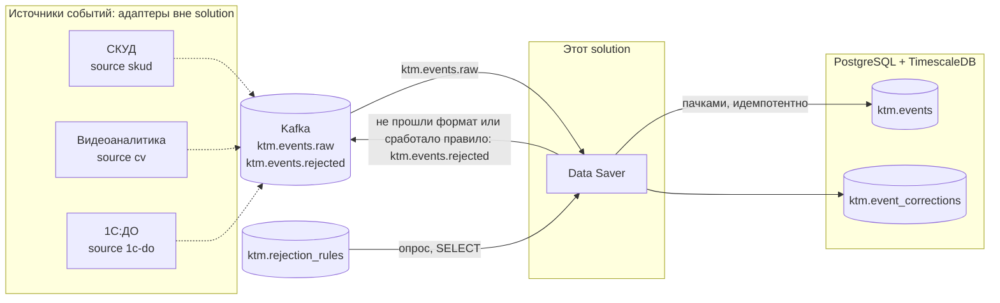
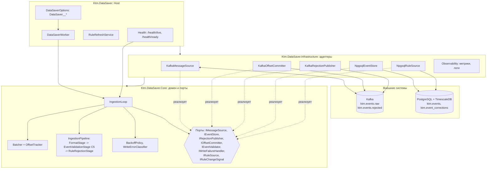
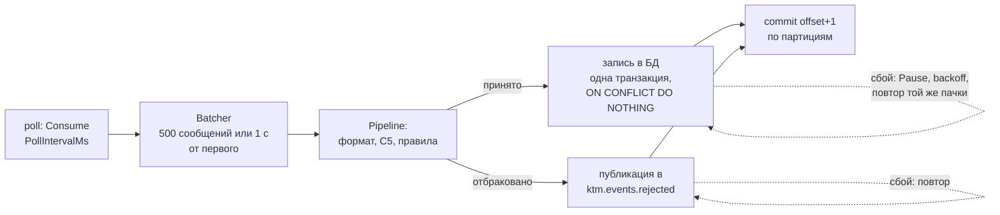

# КТМ backend: solution `src/Ktm`

## 1. Назначение

КТМ - система мониторинга показателей производственной деятельности: сбор, нормализация и интерпретация данных о работе
персонала предприятия из СКУД, видеоаналитики и 1С:ДО (требования - `docs/`). Система выдаёт сигналы, решения принимает
человек; автоматических санкций нет (`docs/01-цели-и-принципы.md`).

Этот solution - серверная часть уровня 1 (сбор): сервис **Data Saver**. Он закрывает задачу надёжного приёма потока событий
в журнал:

```
адаптеры источников -> Kafka ktm.events.raw -> Data Saver -> PostgreSQL + TimescaleDB, таблица ktm.events
                                                  |-> ktm.events.rejected (Kafka): не прошедшие проверку формата и подпавшие под правила отбраковки
                                                  '-> ktm.event_corrections: ссылки корректировок на исходные события
                              правила отбраковки: таблица ktm.rejection_rules (читается опросом, только SELECT)
```

- читает `ktm.events.raw`, проверяет сообщение по `docs/api/kafka-event.schema.json`, затем по правилам отбраковки из таблицы
  `ktm.rejection_rules` (раздел 7), пишет пачками;
- offset коммитится только после COMMIT в БД; идемпотентность гарантирует уникальный ключ
  `(source, source_event_id, occurred_at)`, а не код (`ON CONFLICT DO NOTHING`);
- журнал неизменяем: сервис работает под ролью `ktm_app` (`SELECT, INSERT`), корректировки - отдельными записями;
- недоступность БД или Kafka не теряет данные: пачка повторяется с нарастающей паузой, партиции стоят на паузе.

Вне этого solution: REST API для фронтенда (`ktm_revisor`), ролевая интерпретация, дашборды (правила отбраковки качества
данных - внутри, раздел 7; правила интерпретации уровня 2 - вне). Проект
`Ktm.Api` в solution - шаблонная заготовка (`/weatherforecast`), функционала не содержит.

## 2. Контекст системы

Верхний уровень: пунктиром показано то, что находится вне этого solution.



Формат сообщения источников - `docs/api/kafka-event.schema.json`.

## 3. Схема модулей

Зависимости направлены в сторону `Core`; `Core` не ссылается на Confluent.Kafka, Npgsql и ASP.NET (ADR-0001).



Путь одной пачки (`IngestionLoop`):



Порядок строгий: запись в БД, публикация отбракованных, затем commit. Commit offset учитывает все сообщения пачки,
включая отбракованные.

| Проект | Модуль | Роль |
|---|---|---|
| `Ktm.DataSaver.Core` | `Model`, `Decoding` | `ParsedEvent`, `ConsumedMessage`; `EventDecoder`: JSON -> событие, проверка схемы, UTC-микросекунды, причины отбраковки (`malformed_json`, `unknown_schema_version`, `invalid_schema`) |
| | `Pipeline` | стадии `Accept`/`Reject`, `FormatStage`, порты `IEventValidator` (C5) и `IWriteFailureHandler` (C6) |
| | `Rules` | движок правил отбраковки: `RuleDefinition`, язык условий (реестр операторов, `FieldPath`, `ConditionCompiler`), `RuleSnapshot`, `RuleRejectionStage`, порты `IRuleSource` и `IRuleChangeSignal` |
| | `Batching` | `Batcher` (размер или время), `OffsetTracker` |
| | `Resilience` | `BackoffPolicy`, `WriteErrorClassifier` (временная / конфигурационная / данные) |
| | `Ingestion` | `IngestionLoop`, порты источника, хранилища, публикации, commit, `ISourceTrustProvider`, `IAdminNotifier` |
| `Ktm.DataSaver.Infrastructure` | `Kafka` | consumer, producer `rejected` (идемпотентный, `acks=all`), commit, обработка фатальных ошибок, троттлинг логов librdkafka |
| | `Postgres` | `NpgsqlEventStore` (пакетная запись, корректировки), `NpgsqlRuleSource` (чтение таблицы правил), `PostgresOptions`, `EnvironmentSourceTrustProvider` |
| | `Observability` | метрики `System.Diagnostics.Metrics` (meter `Ktm.DataSaver`), декораторы портов, `LoggingAdminNotifier` |
| `Ktm.DataSaver` | Host | composition root, `DataSaverWorker`, `RuleRefreshService` (первая загрузка и опрос таблицы правил; расположение в Host, а не в Infrastructure - решение лида: сервис использует internal `StartupErrors` и сопрягается с `DataSaverWorker`), опции `DataSaver__*` с проверкой при старте, health (Kestrel), коды выхода |
| `Ktm.DataSaver.Tests` | unit | Core и host на fake-портах |
| `Ktm.DataSaver.IntegrationTests` | интеграционные | Testcontainers: `apache/kafka` и `timescale/timescaledb` pg16; приёмочные, `Long`, `Perf` |
| `Ktm.Api` | - | шаблонная заготовка, не относится к Data Saver |

Вне solution, но нужное для запуска: `db/` (SQL-миграции, ADR-0004), `deploy/data-saver/` (compose), `Dockerfile` в корне.

## 4. Настройки

Все настройки - переменные окружения `DataSaver__<Секция>__<Имя>`; значения по умолчанию заданы в классах options и
проверяются при старте. Ошибка - отказ запуска с сообщением, где названа переменная (значения секретов в него не входят).
Источник: `Ktm.DataSaver/Configuration/DataSaverOptions.cs`, `Ktm.DataSaver.Infrastructure/Kafka/KafkaOptions.cs`,
`Ktm.DataSaver.Infrastructure/Postgres/PostgresOptions.cs`; шаблон - `deploy/data-saver/.env.example`.

Секреты (пароли БД и SASL) задаются **файлом** (`*PasswordFile`, в compose - Docker secret); параметры `Password` и
`PasswordFile` взаимоисключающие. Завершающий перевод строки в файле отбрасывается.

**Обязательные**

| Переменная | Ограничения |
|---|---|
| `DataSaver__Kafka__BootstrapServers` | не пусто |
| `DataSaver__Postgres__Host` | не пусто |
| `DataSaver__Postgres__Database` | не пусто |
| `DataSaver__Postgres__Username` | не пусто (роль `ktm_app`) |
| `DataSaver__Postgres__PasswordFile` или `DataSaver__Postgres__Password` | ровно один из двух; файл должен читаться и быть непустым |

**Kafka**

| Переменная | По умолчанию | Назначение | Ограничения |
|---|---|---|---|
| `DataSaver__Kafka__Topic` | `ktm.events.raw` | входной топик | не пусто |
| `DataSaver__Kafka__RejectedTopic` | `ktm.events.rejected` | топик отбракованных | не пусто |
| `DataSaver__Kafka__GroupId` | `ktm-data-saver` | группа потребителей | не пусто |
| `DataSaver__Kafka__ClientId` | не задан | `client.id` | |
| `DataSaver__Kafka__GroupInstanceId` | не задан | `group.instance.id` (static membership) | уникален на реплику |
| `DataSaver__Kafka__SessionTimeoutMs` | `45000` | session timeout группы | >= 1 |
| `DataSaver__Kafka__ProducerMessageTimeoutMs` | `30000` | предел подтверждения публикации в `rejected` | >= 1; входит в правило `LiveStaleSeconds` |
| `DataSaver__Kafka__SecurityProtocol` | не задан (по умолчанию клиента) | протокол | `PLAINTEXT`, `SSL`, `SASL_PLAINTEXT`, `SASL_SSL` |
| `DataSaver__Kafka__SaslMechanism` | не задан | механизм SASL | `PLAIN`, `SCRAM-SHA-256`, `SCRAM-SHA-512`, `GSSAPI`, `OAUTHBEARER` |
| `DataSaver__Kafka__SaslUsername` | не задан | пользователь SASL | |
| `DataSaver__Kafka__SaslPasswordFile` / `SaslPassword` | не задан | пароль SASL | взаимоисключающие; предпочтителен файл |

Зафиксировано в коде и не настраивается: `earliest` при отсутствии offset группы, автокоммит выключен, `cooperative-sticky`,
producer `rejected` идемпотентный с `acks=all`.

**PostgreSQL**

| Переменная | По умолчанию | Назначение | Ограничения |
|---|---|---|---|
| `DataSaver__Postgres__Port` | `5432` | порт | 1..65535 |
| `DataSaver__Postgres__SslMode` | `Require` | шифрование канала | `Disable`, `Prefer`, `Require`, `VerifyCA`, `VerifyFull`; `Disable` - только для разработки |
| `DataSaver__Postgres__CommandTimeoutSeconds` | `10` | предел одной команды (запись пачки - три обращения) | >= 1 |
| `DataSaver__Postgres__ConnectTimeoutSeconds` | `15` | предел подключения | >= 1 |
| `DataSaver__Postgres__MinPoolSize` | `1` | минимум пула | `0 <= Min <= Max` |
| `DataSaver__Postgres__MaxPoolSize` | `10` | максимум пула | >= 1 |
| `DataSaver__Postgres__KeepAliveSeconds` | `30` | keepalive | >= 0 |

**Приём, повторы, остановка, health**

| Переменная | По умолчанию | Назначение | Ограничения |
|---|---|---|---|
| `DataSaver__PollIntervalMs` | `500` | предел ожидания одного Consume | >= 1 |
| `DataSaver__Batch__MaxSize` | `500` | пачка закрывается по размеру... | >= 1 |
| `DataSaver__Batch__MaxWaitMs` | `1000` | ...или по времени от первого сообщения | >= 1 |
| `DataSaver__Backoff__InitialMs` | `1000` | первая пауза повтора при сбое записи | >= 1 |
| `DataSaver__Backoff__MaxMs` | `30000` | потолок паузы | >= `InitialMs` |
| `DataSaver__Backoff__Multiplier` | `2.0` | множитель | >= 1 |
| `DataSaver__Backoff__JitterFraction` | `0.2` | доля джиттера | 0..1 |
| `DataSaver__Shutdown__TimeoutSeconds` | `30` | предел дописывания пачки от сигнала остановки | >= 1; `stop_grace_period` в compose >= значение + 5 с (сейчас 40 с) |
| `DataSaver__Health__Port` | `8080` | порт health-эндпоинтов | 1..65535 |
| `DataSaver__Health__LiveStaleSeconds` | `60` | через сколько без отметки цикла liveness = 503 | >= 1 и **строго больше** `max(ceil(PollIntervalMs / 1000), Postgres__ConnectTimeoutSeconds + 3 * Postgres__CommandTimeoutSeconds, ceil(Kafka__ProducerMessageTimeoutMs / 1000))`, иначе отказ запуска |

С умолчаниями правило выполняется: `max(1, 15 + 3 * 10, 30) = 45 < 60`.

**Правила отбраковки** (раздел 7)

| Переменная | По умолчанию | Назначение | Ограничения |
|---|---|---|---|
| `DataSaver__Rules__Enabled` | `true` | `false` - ни стадия, ни загрузчик правил не регистрируются, таблица не читается, остальные `Rules__*` не проверяются (аварийное отключение, нужен перезапуск) | `true`/`false` |
| `DataSaver__Rules__RefreshIntervalSeconds` | `60` | период опроса таблицы правил | целое 5..3600 |
| `DataSaver__Rules__MaxRules` | `500` | предел числа применяемых правил (успешно скомпилированных включённых); лишние не применяются, Error на каждое | целое >= 1, верхней границы нет |

**Коэффициенты доверия источников** (задаются переменными окружения, применяются после перезапуска)

| Переменная | По умолчанию | Назначение | Ограничения |
|---|---|---|---|
| `DataSaver__Trust__Default` | `100` | коэффициент по умолчанию | целое 0..100 |
| `DataSaver__Trust__Source__<source>` | - | переопределение для источника, например `...__skud=80` | целое 0..100; имя `<source>` не проверяется, опечатка молча игнорируется |

**Коды выхода процесса**

| Код | Когда |
|---|---|
| `0` | штатная остановка по SIGTERM |
| `70` | фатальная ошибка клиента Kafka |
| `1` | ошибка цикла приёма (лог `Critical`) |
| `78` | ошибка конфигурации: одна строка в stderr с именем настройки; рестарт её не лечит. Для правил: неверное `DataSaver__Rules__*`, а на первой загрузке - нет таблицы `ktm.rejection_rules` (`42P01`, не накатана `V002`) или нет `SELECT` у `ktm_app` (`42501`) |

## 5. Сборка, тесты, запуск

```bash
dotnet build src/Ktm/Ktm.sln
```

Unit и быстрые интеграционные тесты (интеграционным нужен запущенный Docker):

```bash
dotnet test src/Ktm/Ktm.sln --filter "Category!=Long&Category!=Perf"
```

- `Long` - длительные сценарии (остановка БД на 2 минуты, остановка брокера): `--filter "Category=Long"`.
- `Perf` - замер пропускной способности; без параметров `KTM_PERF_*` пропускается. Команды и параметры - в протоколе
  `docs/test-protocols/data-saver-throughput.md`, п. 7.
- Фильтр по умолчанию для `Long` не задан: без `--filter` он запускается вместе с остальными.

Запуск (каталог `deploy/data-saver`; подробности, права файла секрета и остановка - в руководстве):

```bash
cp .env.example .env            # подставить Kafka, хост и базу БД
mkdir -p secrets && printf '%s' '<пароль ktm_app>' > secrets/ktm_app_password
sudo chown 1654:1654 secrets/ktm_app_password && chmod 0400 secrets/ktm_app_password
docker compose up -d --build    # образ собирается из корня репозитория: нужен docs/api
```

Предусловия: БД создана по `db/README.md` (роли, схема `ktm`, миграции `db/migrations/V*.sql`, включая `V002` с таблицей
правил отбраковки; сервис схему не создаёт), топики Kafka созданы заранее.

Health (порт `DataSaver__Health__Port`, внутренняя сеть, без аутентификации):

- `GET /health/live` - 200, пока цикл приёма отмечается; 503 `loop_stalled` или `consumer_fatal_error`. Недоступность БД и
  Kafka liveness не роняет. На него направлен healthcheck контейнера.
- `GET /health/ready` - 200, если выполнена первая загрузка правил (пустая таблица - успех), consumer получил партиции, цикл не
  в `Degraded`, брокер и БД отвечают; иначе 503 с одним из кодов `no_partitions_assigned`, `ingestion_degraded`,
  `broker_unavailable`, `database_unavailable`, а до первой загрузки правил - `rules_not_loaded` (проверяется первым; при этом
  `/health/live` остаётся 200). При `DataSaver__Rules__Enabled=false` `rules_not_loaded` не возникает.

Статус `healthy` в `docker compose ps` готовность не подтверждает: смотрите `/health/ready`.

## 6. Документы

- `docs/adr/0001-backend-stack.md` - стек, структура solution, конфигурация, тесты;
- `docs/adr/0002-data-saver-ingestion.md` - пачки, идемпотентность, offset, сбои, настройки (D-11);
- `docs/adr/0003-data-saver-validation-pipeline.md` - конвейер стадий и точка расширения под правила;
- `docs/adr/0004-db-migrations.md` - миграции SQL-скриптами;
- `docs/adr/0005-data-saver-rules-engine.md` - движок правил отбраковки (таблица правил, язык условий, опрос, контракт `rejected`, метрики);
- `docs/manuals/rules-engine.md` - правила отбраковки для администратора: столбцы, синтаксис условий, SQL-команды, примеры;
- `docs/api/rejection-condition.schema.json` - JSON Schema поля `condition` правила;
- `docs/api/kafka-event-format.md`, `docs/api/kafka-event.schema.json` - формат сообщения;
- `docs/design/Схема_БД_ER.md`, `db/README.md` - схема журнала и порядок применения;
- `docs/manuals/data-saver.md` - руководство по эксплуатации;
- `docs/test-protocols/data-saver-throughput.md` - протокол замера пропускной способности;
- `docs/test-protocols/data-saver-scenario-coverage.md` - сверка сценариев спеков с тестами;
- `openspec/changes/add-data-saver-core/` - proposal, design, specs, tasks;
- `openspec/changes/add-data-saver-rules-engine/` - то же для движка правил отбраковки.

## 7. Правила отбраковки

Стадия `RuleRejectionStage` (`Ktm.DataSaver.Core/Rules`) стоит в конвейере после проверки формата и C5. Для сообщения она
вычисляет включённые правила его источника и общие (`source = '*'`) из таблицы `ktm.rejection_rules` в порядке `priority`, затем
`rule_id`; сработало первое - событие не пишется в `ktm.events`, а публикуется в `ktm.events.rejected` с исходным телом и
заголовками `ktm-reject-reason` (= код правила), `ktm-reject-rule-id`, `ktm-reject-rule-name`, `ktm-reject-rule-version`,
`ktm-reject-detail`; в лог - `Warning`. Правила не знают сотрудников, ролей, смен и оценок: только поля самого сообщения.

- **Хранилище и права.** Таблица создаётся миграцией `V002`, выключенные примеры - `V003`. Сервис (`ktm_app`) правила только
  читает; менять их может `ktm_migrator` либо выданная администратором роль. Аудита изменений нет (временное отступление от
  `docs/04-ролевая-модель.md` п. 4.2/4.4, принято лидом).
- **Язык условий.** JSON в нотации JsonLogic: `and`, `or`, `!`, `==`, `!=`, `<`, `<=`, `>`, `>=`, `var` с точечным путём, диапазон -
  трёхаргументный `<=` с включительными границами. Вычислитель собственный и строгий: типы не приводятся, отсутствующее поле не
  срабатывает (кроме `!=` как отрицания `==`). Операторы регистрируются в реестре; `in`, «пусто/заполнено», регулярное выражение и без
  учёта регистра отложены.
- **Загрузка.** Первая загрузка выполняется до чтения Kafka: `Consume` и commit до неё не вызываются; подписка ленивая (решено, реализовано): consumer
  создаётся и подписывается после первой успешной загрузки. БД недоступна - повтор с backoff, сервис не
  готов; нет таблицы или прав - код 78. Затем опрос раз в `RefreshIntervalSeconds` (60 с по умолчанию). Замена набора атомарна; при сбое чтения действует
  последний валидный набор; ошибочное правило выпадает одно, остальные работают. Перечитывание «по команде» не реализовано.
- **Метрики** (meter `Ktm.DataSaver`): `ktm.datasaver.rules.rejected{source,rule_id}`, `rules.active`, `rules.invalid`,
  `rules.reloads{result,trigger}` (`trigger`: `startup`/`timer`; `signal` зарезервирован, сейчас не выдаётся), `rules.snapshot_age`;
  для правила `messages.rejected{reason="rule_matched"}`. `rules.active` - применяемые правила (включённые и без ошибок).
- **Настройки** - таблица в разделе 4. `DataSaver__Rules__Enabled=false` отключает правила без пересборки (нужен перезапуск процесса).

Описание для администратора и примеры - `docs/manuals/rules-engine.md`; эксплуатация - `docs/manuals/data-saver.md`, п. 11.
